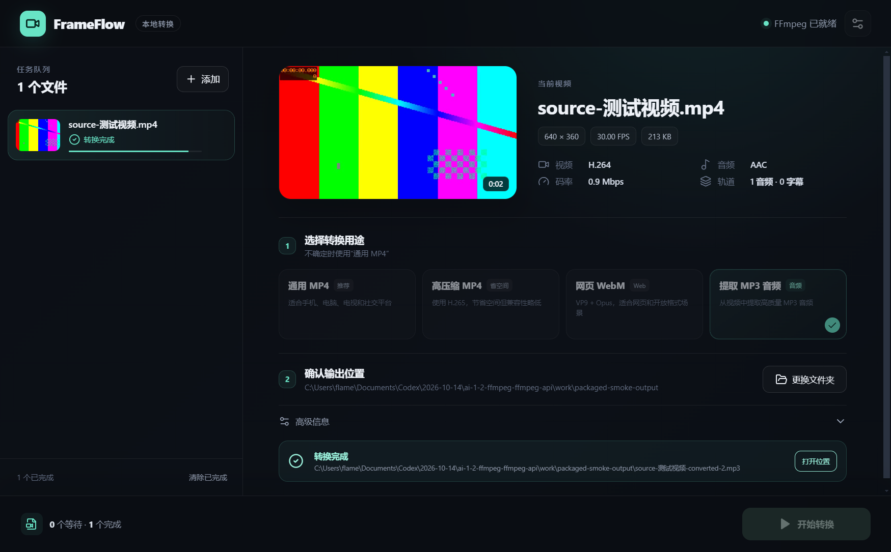

# FrameFlow

FrameFlow 是一款面向普通用户的 Windows 桌面视频格式转换器。它用用途预设代替复杂参数，所有媒体分析、缩略图生成和转码都在本机通过 FFmpeg 完成。

> 当前状态：v0.1.0 MVP 已完成。Windows 安装版、免安装版、打包后 Electron 客户端和四种真实转码预设均已通过验收。



## 已实现

- 拖放或文件选择导入多个视频
- 使用 ffprobe 读取时长、分辨率、帧率、编码、码率和轨道信息
- 使用 FFmpeg 在视频约 10% 位置生成缩略图
- 通用 MP4、H.265 MP4、WebM 和 MP3 提取四种用途预设
- 顺序任务队列、实时进度、速度显示和单任务取消
- 输出文件自动避让同名文件，不静默覆盖原文件
- 临时文件转码、完成后 ffprobe 校验、校验通过后原子改名
- Main 端单任务并发闸门和 Windows FFmpeg 进程树取消
- IPC 调用来源、路径、扩展名、文件类型、输出目录写权限和 500 GB 上限校验
- 输出时长、轨道、编码、分辨率和帧率结构校验
- 转换完成后打开文件位置
- 960 × 640 最小窗口布局

## 技术栈

- Electron + React + TypeScript + Vite
- Zustand
- FFmpeg / ffprobe 命令行
- Vitest + Playwright
- electron-builder

## 本地运行

需要 Node.js 20+、pnpm 11+。首次安装会下载 Electron、FFmpeg 和 ffprobe，网络较慢时可能需要等待。

```powershell
pnpm install
pnpm dev
```

只预览和验收界面：

```powershell
pnpm dev:renderer
```

## 验证

```powershell
pnpm typecheck
pnpm test
pnpm build
pnpm test:media
pnpm package:win
pnpm test:packaged
```

`test:media` 会生成带中文文件名的短视频，验证探测、缩略图、WebM 转换和输出校验。`test:packaged` 会启动 `release/win-unpacked` 中的正式客户端，验证打包内 FFmpeg、缩略图、文件与文件夹选择 IPC、“打开位置”调用，以及 H.264、H.265、VP9、MP3 四种真实输出。

## Windows 打包

```powershell
pnpm package:win
```

打包前脚本会把 FFmpeg 和 ffprobe 固定复制到 `resources/bin`，避免包管理器软链接布局影响资源收集。正式发布前还需完成 FFmpeg 构建及编解码器许可证核对。

成功后生成：

- `release/FrameFlow Setup 0.1.0.exe`：可选择安装目录的安装版。
- `release/FrameFlow 0.1.0.exe`：免安装便携版。

v0.1.0 安装包尚未配置 Windows 代码签名，首次运行时系统可能显示信誉提示。SHA-256 校验值见 `outputs/FrameFlow-0.1.0-SHA256.txt`。

## 架构与决策

- [架构说明](docs/ARCHITECTURE.md)
- [开发决策记录](docs/DECISIONS.md)
- [使用与验收手册](docs/ACCEPTANCE.md)
- [安全与稳定性加固复核](outputs/安全加固复核-2026-10-14.md)
- [方案设计与技术选型](outputs/视频格式转换器方案设计与技术选型.md)

## 许可证

应用源码采用 MIT License。FFmpeg、ffprobe 及其编解码器遵循各自许可证，分发前请同时阅读 `THIRD_PARTY_NOTICES.md`。
